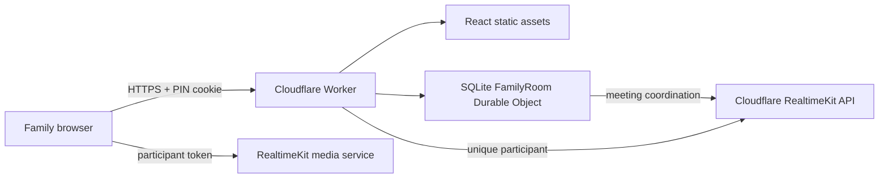

# Family Call

A private family video-call application hosted as one Cloudflare Worker. Family members open the permanent `/family` link, enter a six-digit PIN and their name, check their camera and microphone, and join the same RealtimeKit group call.

They do not need a Cloudflare account, email login, application installation, or custom domain.

## Architecture



The Worker validates the PIN, creates HMAC-signed sessions, enforces CSRF and rate limits, and calls RealtimeKit with a server-only API token. The Durable Object stores only the current meeting ID and PIN-attempt counters. It never stores audio or video.

## Requirements

- Node.js 22 or newer from [nodejs.org](https://nodejs.org/)
- A Cloudflare account
- A Cloudflare RealtimeKit application and participant preset
- Wrangler authorization (`npx wrangler login`)

## Install and run locally

```bash
npm install
cp .dev.vars.example .dev.vars
npm run dev
```

Fill `.dev.vars` with the Account ID, RealtimeKit App ID, preset name, restricted API token, six-digit PIN, and a random session secret. Generate the session secret with:

```bash
openssl rand -base64 48
```

Camera and microphone access require HTTPS except on `localhost`. To test from another phone, deploy to the HTTPS `workers.dev` address rather than opening a LAN HTTP address.

## Cloudflare setup

1. Create a RealtimeKit application in the Cloudflare dashboard.
2. Use `group_call_participant`, or another preset that permits publishing and receiving audio/video.
3. Create a restricted API token with Account → Realtime → Realtime Admin permission for the selected account.
4. Put the non-secret Account ID, App ID, and preset in `wrangler.jsonc`.
5. Store production secrets interactively:

```bash
npx wrangler secret put CLOUDFLARE_API_TOKEN
npx wrangler secret put FAMILY_PIN
npx wrangler secret put SESSION_SECRET
```

6. Deploy. The deployment helper temporarily hides the local `.env` file so its restricted RealtimeKit token cannot be mistaken for Wrangler's OAuth credential:

```bash
npm run deploy
```

Wrangler prints a URL like `https://s-chat.<account-subdomain>.workers.dev`. Share its `/family` path. A custom domain is optional.

## Commands

```bash
npm run dev        # local development
npm run typecheck  # TypeScript validation
npm run lint       # ESLint
npm test           # Worker-runtime tests with mocked RealtimeKit calls
npm run build      # production build
npm run deploy     # build and deploy
```

## Security and maintenance

- Never commit `.env`, `.dev.vars`, API tokens, the family PIN, or session secret.
- Change the PIN with `npx wrangler secret put FAMILY_PIN` and deploy again if necessary.
- Rotate the API token in Cloudflare, then update `CLOUDFLARE_API_TOKEN` with Wrangler.
- View sanitized logs with `npx wrangler tail`. Submitted PINs, tokens, and meeting IDs are not logged.
- Delete the deployment with `npx wrangler delete s-chat`.

## Camera and microphone troubleshooting

- Use current Chrome, Edge, Safari, iOS Safari, or Android Chrome.
- Confirm the browser gives the site camera and microphone permission.
- iPhone users can review Safari permissions under Settings → Apps → Safari.
- Android users can review browser and site permissions under Settings → Apps.
- A denied or missing camera does not prevent an audio-only call.
- Browsers require a user action before device access; permissions are requested by the RealtimeKit setup screen.

## Cost

RealtimeKit is currently free during its beta period. Cloudflare has announced usage-based pricing after general availability. Workers and SQLite Durable Objects have free-plan allowances appropriate for a small family application. Verify the current [Workers pricing](https://developers.cloudflare.com/workers/platform/pricing/) and [RealtimeKit pricing](https://developers.cloudflare.com/realtime/realtimekit/pricing/) before continued use.
